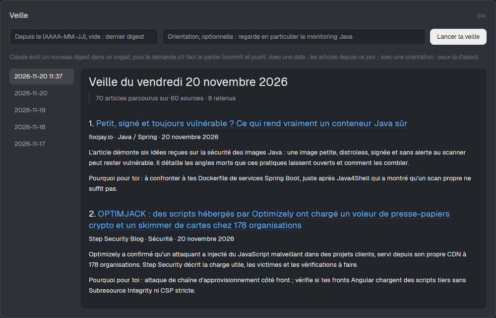

# TechWatch

A personal daily tech watch. Every morning a script reads the RSS and Atom feeds you chose,
Claude Code keeps the 5 to 10 items that match a written profile, and the result lands as
a Markdown digest committed to this repository.

One place to read, no feed reader to scroll, and a history you can grep.

## How it works

```
sources.md ──> techwatch-fetch ──> JSON of new items ──> /veille (Claude Code) ──> digests/YYYY-MM-DD-HHMM.md
                (Python, stdlib)                           filters with profil.md      committed and pushed
```

1. **Collect.** `techwatch-fetch` downloads every feed listed in `sources.md` and keeps
   the items published since the last digest (at least 36 hours, at most 7 days). An
   item whose URL already appears in a digest is dropped, and so is anything past 15
   items per feed.
2. **Filter.** The `/veille` Claude Code command reads `profil.md` (who you are, your
   stack, what you want and what you don't) and picks between 5 and 10 items. It also
   receives the titles of the last 14 days of digests, so a story already covered under
   another URL is not proposed again.
3. **Write.** Each item gets a two-sentence summary and a "why it matters to you" line
   tied to the profile. For a release, a deprecation or a vulnerability, `techwatch-stack`
   tells which of your repositories use it and in which version, so the line names them. Feeds that failed are listed at the end, so `sources.md` can be
   fixed.
4. **Publish.** `scripts/keep.sh` commits the digest and pushes it. Run by hand, `/veille`
   first asks whether to keep the digest; the daily job, `scripts/daily.sh`, keeps it
   without asking. A systemd user timer runs the daily job at 08:00, catches up at the
   next boot when the machine was off, and skips the day if a digest already exists.

The digest and the profile are in French. Change the language in
`.claude/commands/veille.md`.

## Requirements

- Linux with systemd, for the daily timer. Everything else works anywhere.
- [mise](https://mise.jdx.dev), which installs Python 3.13 and uv.
- [Claude Code](https://claude.com/claude-code), logged in. Each digest is one Claude Code
  session (headless for the daily job) and uses your plan or API usage.
- A git remote, if you want the digests pushed.

## Getting started

Click **Use this template** on GitHub to create your own repository (private is a good
idea: your profile and digests say a lot about you), clone it, then:

```sh
mise install && mise run install   # Python, uv, dev tools (the fetcher itself has no dependency)
mise run sources                   # check every feed answers
mise run veille                    # write, commit and push a digest
mise run install-timer             # run it every morning at 08:00
```

Then make it yours, before the first digest:

- **`profil.md`** is the filter; the one here is an example to replace. When a digest
  misses, edit the profile rather than the prompt: add an interest, sharpen an exclusion.
- **`sources.md`** lists the feeds, one `- <url>  # label` per line under a
  `## <category>` heading. Run `mise run sources` before adding one: some sites refuse
  scripts.

## Everyday use

| Command | What it does |
| --- | --- |
| `claude "/veille"` | A new digest in an interactive session; Claude then asks whether to keep it (commit and push) or drop it. |
| `claude "/veille 2026-11-15"` | The same, with the items since that date. |
| `claude "/veille regarde en particulier le monitoring Java"` | The same, ranking first what matches this focus (a date can come before it). |
| `mise run veille [2026-11-15]` | The daily job by hand: a new digest, headless, committed and pushed without asking. |
| `mise run sources` | Health of every feed: item count, newest date, failures. |
| `journalctl --user -u techwatch` | Logs of the daily runs. |

Each run writes its own file, `digests/YYYY-MM-DD-HHMM.md`: a second run on the same day
never overwrites the first.

## Your stack

`techwatch-stack` reads the build and container files of the git checkouts under
`~/Code` (or the colon-separated folders of `TECHWATCH_CODE`): Gradle version catalogs
and `build.gradle(.kts)`, Maven `pom.xml`, `pyproject.toml` with `uv.lock`,
`package.json`, Dockerfile `FROM` and compose `image:` lines, and runtime versions from
mise, `.tool-versions`, `.python-version` and Java toolchains.

```sh
uv run techwatch-stack                         # what was found, per kind
uv run techwatch-stack "spring boot" nginx     # which repositories use them, per version
```

Nothing is stored: each call reads the working trees as they are. Versions set elsewhere
(a BOM, an Ansible variable, a CI parameter) are not seen, nor Groovy `build.gradle`
dependencies written with named arguments. Digests then name your repositories: one more
reason to keep your copy private.

## Reactions and an evolving profile

Every digest item can get a 👍 or a 👎 (from the Herdr mod, or
`uv run techwatch-react 1 <url>`; `-1` for 👎, `0` to take it back). Votes go to
`reactions.jsonl`, one line each, versioned with the rest. Now and then, run
`claude "/profil"`: Claude looks for patterns in the votes, proposes the smallest edits to
`profil.md` that explain them, applies the ones you pick and commits them.

## Herdr mod

For [Herdr](https://herdr.dev) users, `herdr/techwatch/` is a mod that opens as a dialog:
the digests on the left, the selected one rendered on the right, and a field to start a
run, with an optional start date and focus: Claude writes the digest in a new tab, then asks
whether to keep it. Each item has 👍/👎 buttons that record your reactions.



```sh
mise run install-herdr-mod   # links the mod into ~/.config/herdr-app/mods/
```

Then bind a key in `~/.config/herdr-app/keys.json`, under `global`:
`"ctrl-shift-d": "mod.open:techwatch"`.

## Things to know

- **Permissions.** `.claude/settings.json` lets `/veille` run the fetcher and
  `scripts/keep.sh`, read files, edit `digests/` and fetch web pages. Nothing else runs
  without a prompt, and `keep.sh` commits nothing but an existing file of `digests/`.
- **History drives the dedup.** Renaming or rewriting old digests changes what gets
  proposed next.
- **Reddit** answers 404 to anonymous feeds since November 2026; it would need its
  official API with an OAuth app.
- **Moving the clone.** `mise run install-timer` and `mise run install-herdr-mod` record
  the clone's path: run them again after moving the repository.

## Getting the template's updates

A repository created from a template does not follow it. To pull later improvements of
the engine, add the template as a second remote once:

```sh
git remote add upstream https://github.com/Jin66/techwatch-template.git
git fetch upstream
git merge --allow-unrelated-histories -s ours upstream/main -m "Track the template"
```

The `-s ours` merge keeps all your files and only records where you started from. After
that, `git fetch upstream && git merge upstream/main` brings in what changed since.

## Development

```sh
mise run check   # lint, format, types and tests: green before any commit
mise run fix     # auto-format and auto-fix lint
```

Tests need no network. Conventions for humans and agents are in [AGENTS.md](AGENTS.md).
